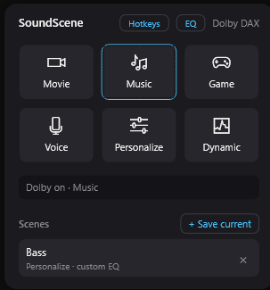
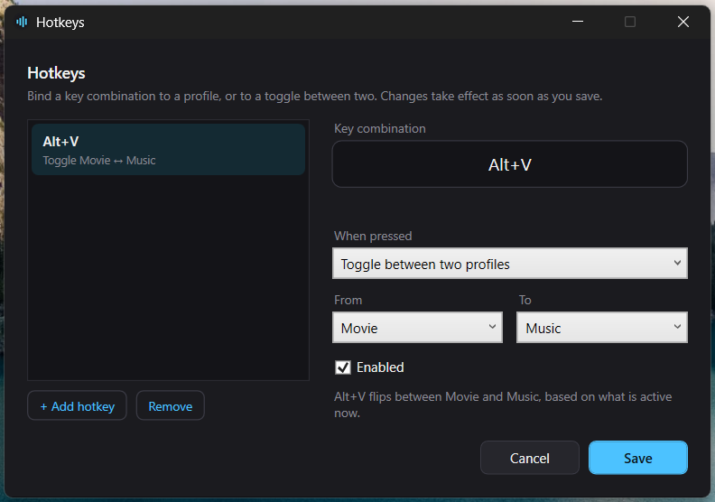
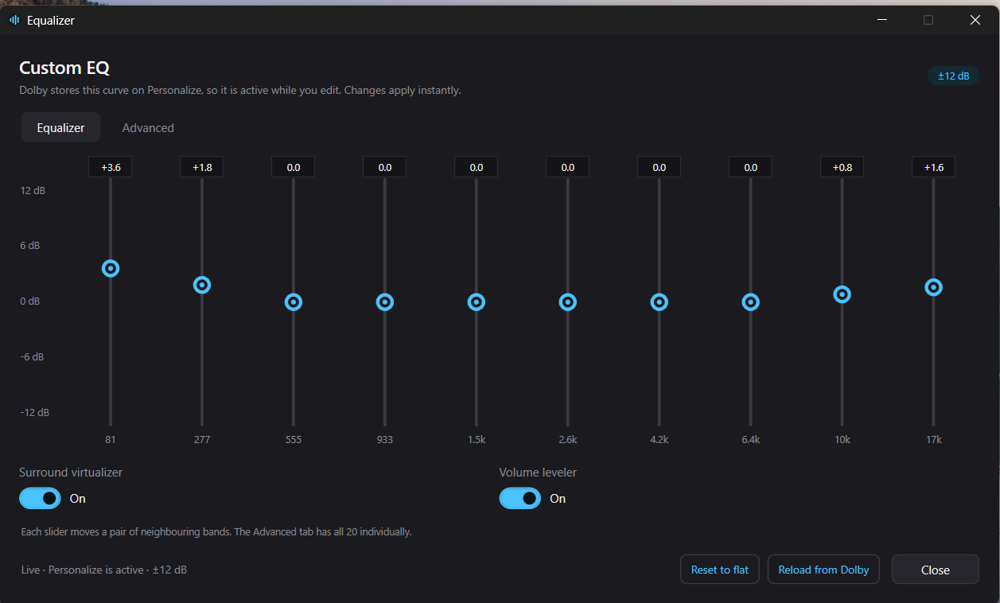

# SoundScene

[](https://github.com/v0ll/SoundScene/releases/latest)
[](https://github.com/v0ll/SoundScene/actions/workflows/build.yml)
[](LICENSE.md)

A LIGHTWEIGHT companion app for **Dolby Access** that lets you flip between profiles and settings
INSTANTLY on ASUS ROG Zephyrus laptops. SoundScene is a controller, not a replacement: Dolby Access
and the ASUS Dolby Atmos driver must already be installed.



Does it all from a tray icon, a global hotkey, or a compact popup - instead of opening the Dolby app and clicking through the UI every time, while idling at only few megabytes.


## Why

Some of the ASUS ROG Zephyrus laptops newer than 2020 ships with Dolby Access, but the app itself lacks QoL. 

Switching from one profile to another literally means opening the app, waiting for it to load, and navigating. There is nothing that makes changing profiles less time consuming.

Tested on the **ROG Zephyrus G14 GA403UV** with Windows 11 and Dolby Access 3.27. Other DAX3-based
ROG models should work, but have not been verified.

## Features

- **Instant profile switching** - with your designated macro key, main profiles (Movie / Music / Game / Voice / Personalize / Dynamic).
- **Scenes** - save the current profile and custom EQ as a named scene, recall it with one click.
  Stored as plain JSON in your own user profile.
- **Macro hotkeys** - as many as you want. Each one either switches straight to a profile or
  toggles between two, with a single global key combination. The editor is available from the
  popup header and the tray menu; existing single-toggle settings are migrated automatically.

  

- **Tray-first UI** - compact popup for quick switching and scene recall. Number keys 1-6 pick a
  profile, Escape closes it.
- **Low idle footprint** - Idle private working set is a few MB; the popup costs tens of MB only while it is open.
- **One process** - a second launch wakes the running instance instead of racing it for the
  same DAX profile.
- **Start with Windows** - OPTIONAL entry, toggled from the tray menu.
- **EQ editor** - a simple 10-slider view by default, with all 20 driver bands behind an
  **Advanced** tab. Type a level in dB or drag a slider; values snap to flat near 0 dB and
  changes are written immediately. Includes Dolby's volume leveler and surround virtualizer
  switches. The curve and switches live on Personalize, so the editor activates it while open.



## INSTALLING

Download the **[latest release](https://github.com/v0ll/SoundScene/releases/latest)** and run
`SoundScene-Setup-x.y.z.exe`. It installs for the current user only, so there is no elevation
prompt, and it adds SoundScene to Settings > Apps for clean removal.

The installer is **not code-signed yet**, so Windows SmartScreen may say "Windows protected your
PC". Verify the download against `SHA256SUMS.txt` on the release page first:

```powershell
Get-FileHash .\SoundScene-Setup-0.2.1.exe -Algorithm SHA256
```

Then choose **More info > Run anyway**.

`SoundScene-Portable-x.y.z.zip` is the alternative: extract it anywhere and run
`SoundScene.App.exe`. Settings, scenes, and the private Dolby client cache live in the `data`
folder next to the executable, and "Start with Windows" is disabled so deleting the folder removes
everything.

The first launch checks the prerequisites and offers a **Set up** button if something is missing.
The same checklist is available later from the tray menu under **Setup requirements…**.

For development, build the native bridge and install the framework-dependent build:

```powershell
cmake --build native\build --config Release
powershell -ExecutionPolicy Bypass -File tools\install.ps1
```

The app lives in the tray. Left-click the icon for the popup, right-click for the graphic
equalizer, hotkeys, setup, diagnostics, and exit. Scenes and settings are stored under
`%APPDATA%\SoundScene\` for a normal install, or under `data\` for a portable copy.

## UNINSTALLING

Use **Settings > Apps > SoundScene > Uninstall** (or the installer's uninstaller). It stops the
app and asks two questions:

- **Delete settings and scenes?** Yes removes `%APPDATA%\SoundScene`; No keeps them for a future
  reinstall.
- **Reset Dolby EQ, leveler, and surround?** No by default, because the last profile and curve are
  legitimate Dolby state. If selected, SoundScene puts Personalize back to flat/off before it is
  removed.

The uninstaller always removes the install folder, Start Menu/desktop shortcuts, the
`Start with Windows` entry, and `%LOCALAPPDATA%\SoundScene` (the copied Dolby client cache). It
does **not** remove Dolby Access, the ASUS driver, or `C:\ProgramData\Dolby\DAX3\Runtime.xml`.
For a script-based install, `tools\uninstall.ps1` does the same cleanup.

A scene records the active profile, and the EQ curve only when it was captured on **Personalize** -
Dolby keeps equalizer levels per profile and only exposes them on that one, so capturing zeros from
Movie would be a lie.

## KNOWN LIMITATIONS

- **Dolby Access and the ASUS Dolby Atmos driver are both required.** The driver alone provides the
  service and APOs, but not the client API SoundScene uses.
- Tested on the G14 GA403UV with Windows 11 (build 26100). Windows 10 2004+ is supported by the
  build and installer, but has not been tested on hardware yet.
- The Dolby Access package family is currently hardcoded. A machine with a different Dolby/OEM
  package will show the setup checklist even if another Dolby app is installed.
- The installer is not code-signed yet, so SmartScreen may warn. Verify `SHA256SUMS.txt`.
- There is no auto-update yet; check the releases page for new versions.
- SoundScene changes the active Dolby profile and Personalize EQ state as part of normal use. The
  uninstaller leaves those changes alone unless you enable the optional Dolby reset.

## SUPPORT

Open an issue at <https://github.com/v0ll/SoundScene/issues>. Include the output of the app's
**Diagnostics** window, your Windows build, Dolby Access version, and laptop model. For security
reports, follow [`SECURITY.md`](SECURITY.md) instead of opening a public issue.

## Architecture

```
SoundScene.App  (WPF / .NET 10)
      |
SoundScene.Core  (profiles, scenes, hotkeys, persistence)
      |
IAudioBackend
      +-- DolbyDaxBackend      -> native C++/WinRT bridge -> DAX.CDolbyDAX
      +-- EqualizerApoBackend  -> Equalizer APO config files
      +-- MockBackend          -> in-memory, for tests and UI work
```

The native bridge is a thin C++/WinRT layer exposing a small C ABI, because the DAX WinRT component
cannot be consumed directly from .NET without a projection we don't control.

## REQUIREMENTS

- Windows 10 version 2004 (build 19041) or newer, or Windows 11, x64
- **Dolby Access** installed for your Windows user. It is free from the Microsoft Store
  ([product ID 9N0866FS04W8](ms-windows-store://pdp/?productid=9N0866FS04W8)).
- The ASUS/Realtek **Dolby Atmos driver**, which installs the `DolbyDAXAPI` service and the APOs.

**The driver alone is not enough.** The driver provides the DAX service and audio processing, but
the supported control API (`DAXRPCClient.dll` / `DAX.winmd`) ships only in the Dolby Access package.
SoundScene copies that client at runtime; it does not bundle or redistribute any Dolby binary. With
only the driver, the app installs and opens but cannot change profiles or EQ, so it shows a setup
checklist and a Store button instead.

- .NET 10 SDK, only if you build from source. The release installer is self-contained.
- Visual Studio 2022 Build Tools with **Desktop development with C++**, only for the native bridge.

## BUILDING

```powershell
dotnet build SoundScene.slnx
```

The native bridge is built separately with CMake:

```powershell
cmake -S native -B native/build -G "Visual Studio 17 2022" -A x64
cmake --build native/build --config Release
```

## PACKAGING

The release build is self-contained `win-x64`, so users do not need the .NET runtime:

```powershell
winget install JRSoftware.InnoSetup
powershell -ExecutionPolicy Bypass -File tools\package.ps1
```

That writes `SoundScene-Setup-x.y.z.exe`, `SoundScene-Portable-x.y.z.zip`, and `SHA256SUMS.txt` to
`dist\`. Bump `VersionPrefix` in `Directory.Build.props` before a release. The artifacts are
unsigned, so Windows SmartScreen may warn; publish the SHA-256 file alongside them.

## TESTING

```powershell
dotnet test SoundScene.slnx -c Release
```

## LEGAL

SoundScene is an independent, unofficial project. It is **not affiliated with, endorsed by, or
supported by Dolby Laboratories or ASUSTeK Computer Inc.** "Dolby", "Dolby Atmos", and "Dolby
Access" are trademarks of Dolby Laboratories.

This project does not include, bundle, decompile, or redistribute any Dolby binaries. It only calls
APIs already installed and licensed on the local machine, in the same way any audio application
does. No copy protection, licensing check, or DRM mechanism is bypassed. If the vendor's
components refuse third-party callers, that is respected - the Equalizer APO backend exists
precisely so the app remains useful in that case.

Use at your own risk. Modifying audio driver state can, in principle, leave a machine with no sound
until the driver is reset. Back up `C:\ProgramData\Dolby\DAX3\Runtime.xml` before experimenting.

The trademark and third-party notice is kept separately in [`NOTICE.md`](NOTICE.md).

## License

MIT - see [LICENSE.md](LICENSE.md).
